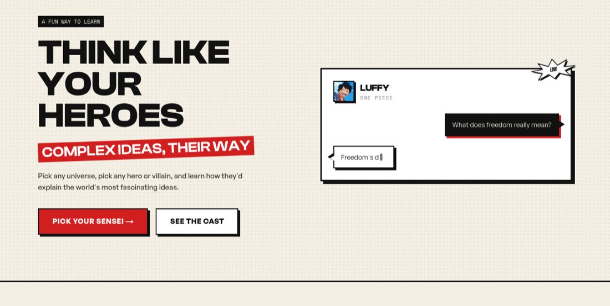
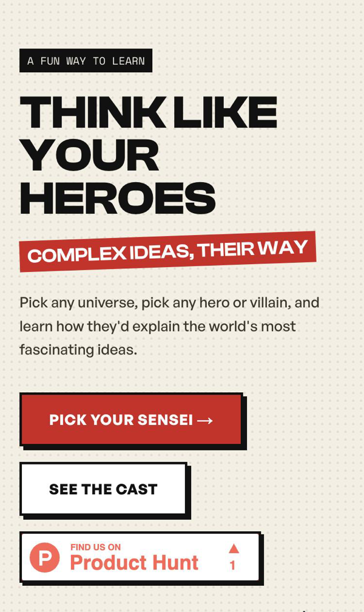
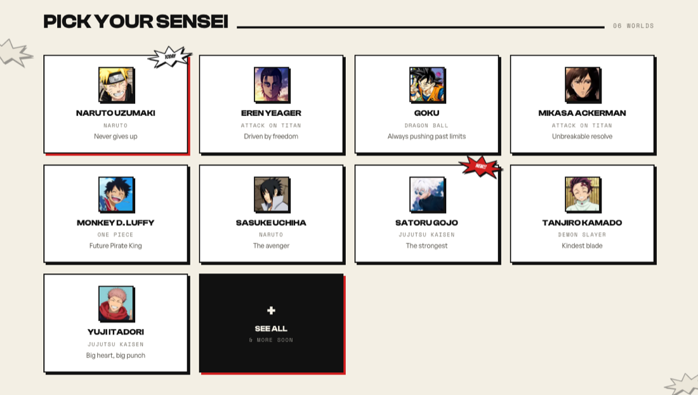
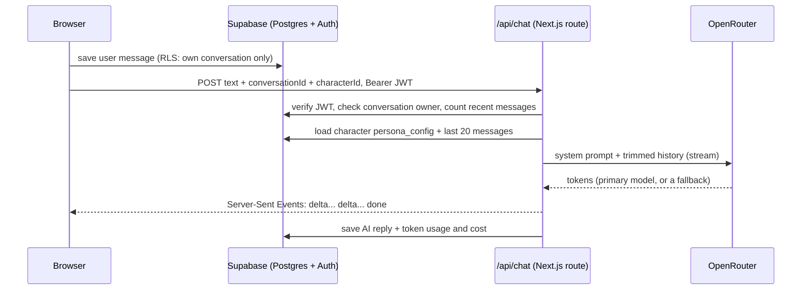

# Verse Sensei

Chat with anime characters who actually stay in character, and get complex ideas explained the way they'd explain them. Naruto on quantum computing, Goku on compound interest, Luffy on what freedom means.

> The source code is private. This repo is a write-up of what it does and how it's built.

## Why I built it

People already get attached to fictional characters. I learn things way better when they're wrapped in a story than when they're in a tutorial, and I figured a lot of anime fans are the same. If Naruto explains perseverance, it lands differently than a listicle does.

Most "chat with a character" apps feel like a generic assistant wearing a costume: same greeting, same tone, a character name stuck on top. I wanted the opposite. The persona is the whole product, so every design and engineering call had to make it feel more like talking to the actual character.

## What it does

- **Pick a world, pick a character** (hero or villain): 9 characters across Naruto, One Piece, Attack on Titan, Dragon Ball, Jujutsu Kaisen and Demon Slayer.
- **Streaming, in-voice replies.** Stage actions like `*grins*` render in red italics, and the rest is a small markdown renderer (lists, bold, code) styled to match.
- **Three modes on a fresh chat:** EXPLAIN, HYPE ME and JUST TALK. Each has its own pool of prompts written in that character's voice, sampled randomly so the empty state isn't the same menu every time.
- **The character locks once you start talking.** Swapping personas mid-thread breaks the illusion, so changing character means starting a new chat.
- **Saved history**, search (⌘K), and email, magic-link or Google sign-in.
- **Phone-first.** The sidebar becomes a slide-over, the composer stays above the keyboard, and the cast turns into a swipe rail.

  
  

## How it works

It's a Next.js 15 App Router app on Vercel with Supabase for auth and data. Characters are pure data: each one is a row with a `persona_config` JSON that holds both halves of the persona, the roleplay voice the model sees (style, quirks, catchphrases, taboos, what they'd know) and the UI copy (greetings, prompt pools per mode, even their own lines for when you hit a rate limit). Adding a character means inserting a row and dropping in a portrait. No code changes, no deploy.

The browser never talks to the model. `/api/chat` owns the prompt, the provider key and the reply, and it streams tokens back as Server-Sent Events.

## The interesting problems

### The free model was quietly writing junk into people's chats

I started on a free OpenRouter model. Free routes share capacity with everyone, so I was getting 429s, and the original fallback handled errors by replying `Got it: <your message>` and **saving that to the database as a real AI message**. Every rate-limit hit permanently wrote an out-of-character line into someone's history. That was the worst possible failure for a product whose whole pitch is "stays in character".

The fix had a few parts:
- Moved to a paid model (`deepseek-v4-flash`). It was near the top of OpenRouter's roleplay usage rankings and the cheapest of the models I compared, at roughly $0.00004 per message in testing.
- Added a fallback chain across **three different providers** (DeepSeek → Xiaomi → MiniMax), so one outage doesn't take the others down with it.
- Errors now send an SSE `error` event, the client shows a red error bubble with RETRY, and **nothing gets saved**.
- It's a reasoning model, so it was streaming thinking tokens before any visible text. Turning reasoning off removed that delay and those billed tokens.
- The model that actually answered is read off the stream and logged. OpenRouter returns dated IDs like `…-20260423`, so the check is a prefix match. An exact string comparison would have reported "running on backup" on every message.
- Each request sets `provider.data_collection: "deny"`, so chats only go to providers that don't keep or train on prompts.

### Cost protection without a Redis

Once there was a paid key, any signed-in user could run up the bill. The client already saves the user's message before calling the API, so the `messages` table *is* the counter: two head-count queries give a limit of 30 per hour and 150 per day, with no extra infrastructure. Going over returns a 429 with a line sampled from **that character's own** `rate_limit_lines`, so even the error stays in voice. Other guards: `max_tokens` at 700, older history turns capped at 600 characters so one huge paste doesn't get re-sent on every message, and a `usage_log` table that records exact token cost per reply.

### Locking down the database (my own mistake)

The chat route uses the service-role key, so it checks conversation ownership in code. The browser, though, reads and writes some tables directly with the anon key. When I probed the database as an anonymous client, I found `universes` readable by anyone and leftover UPDATE/DELETE grants on `conversations` and `messages`, with RLS as the only thing in the way and policies I couldn't fully verify. I rewrote it from scratch: dropped every existing policy, recreated a minimal set scoped by `auth.uid()`, only allowed message inserts with `sender = 'user'` in your own conversations (AI rows can only come from the server), and revoked every anon grant. After that, all 10 anonymous probes were denied.

### Tokens in the URL bar

Google OAuth and magic links originally redirected straight to `/chat`. Under the implicit flow, that can leave `access_token` and `refresh_token` sitting in the URL fragment of an app page, where they show up in history and screenshots. Now every auth return goes through a dedicated `/auth/callback` page that swaps a PKCE code for a session, strips any old token fragments, and only redirects to internal paths.

### The chat was reading the wrong end of the conversation

History loading asked for 20 messages ordered oldest first, so after a long chat the model was seeing the *opening* of the conversation instead of the latest turns. The current message was also sometimes included twice, once from the database and once appended. Now it fetches the newest 20, drops the just-saved turn, appends it exactly once, and restores chronological order. RETRY reuses the existing user message instead of duplicating it.

### Making a manga page work as an app

The visual system is "ink on paper": cream canvas, ink borders, one red accent, hard offset shadows with no blur, zero border radius anywhere, and halftone dot texture. Comic sound effects (`WHOOSH!` on send, `DON!!` on picking a character) pop only on a few chosen actions so they keep their impact, and all motion respects reduced-motion settings. Two bugs from building it:
- Tailwind v4 puts utilities in a CSS layer, but the app's old global `button` and `input` rules were unlayered, so they beat the utilities. `bg-red` silently did nothing on plain buttons. I moved those rules into `@layer base`.
- While streaming, the reply renders inline so the `▍` cursor stays on the same line. Once the reply finishes it switches to the block markdown renderer. That swap first dropped the cursor onto a new line and then collapsed paragraph spacing, so the rendering is split into two phases.

## Stack

Next.js 15 (App Router) · React 19 · TypeScript · Tailwind CSS v4 · Framer Motion · Supabase (Postgres, Auth, RLS) · OpenRouter (Server-Sent Events streaming) · Vercel · GitHub Actions (typecheck, lint, build)

## Limits

- **It's an unofficial fan project.** The characters belong to their creators. The site says so, and it's why the paid "Sensei Pass" is only a teaser for now. Charging money for conversations with someone else's characters is a decision I want to make carefully, not by default.
- **No test suite yet.** CI covers types, lint and a production build. Most of the bugs above were caught by hand.
- **Stop doesn't stop the server.** Cancelling a reply stops the stream in the browser, but the server still finishes generating it, pays for it and saves it. Fixing that needs a protocol change I haven't made.
- **Persona quality depends on the model.** The persona JSON steers voice well, but a long chat can still drift toward the model's own tone.
